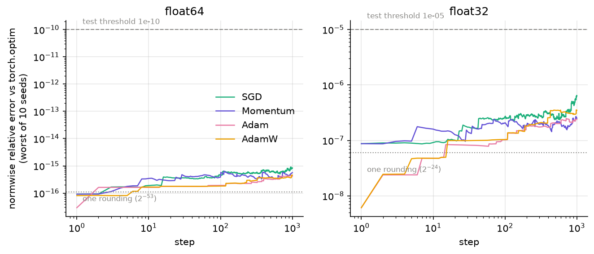
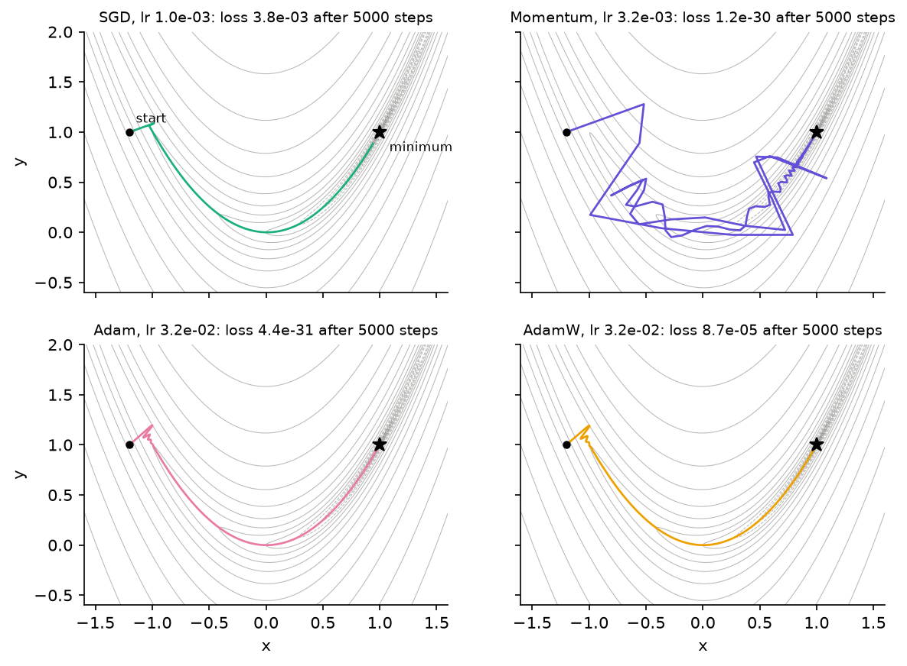
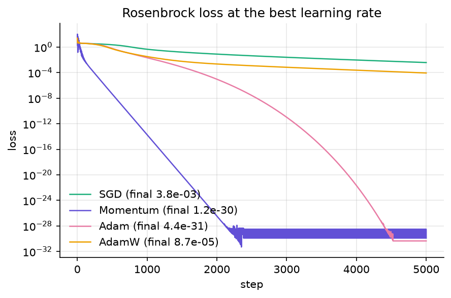
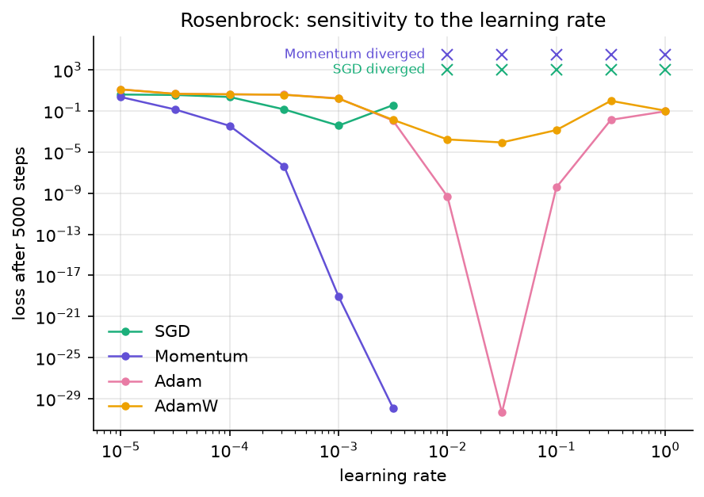

# optimizers-low-precision

[](https://github.com/amine-belkacem/optimizers-low-precision/actions/workflows/tests.yml)

I am writing SGD, Momentum, Adam and AdamW from scratch in NumPy, checking them
against `torch.optim`, and then looking at what happens to each of them when
the arithmetic drops to fp16, bfloat16 or fixed point, the way it does when you
try to train on a microcontroller, an accelerator or an FPGA.

> Work in progress. This repository is built in milestones and this README
> only describes what is already in it. Every number below comes from a
> script in this repository and can be regenerated.

## Status

| Milestone | Content | State |
|---|---|---|
| J0 | Repository skeleton, CI, figure style | done |
| J1 | The four optimizers, differential tests against PyTorch, Rosenbrock | done |
| J2 | NumPy MLP on `digits`, learning-rate sensitivity over 10 seeds | next |
| J3 | Number format emulator (fp32, fp16, bf16, Qm.n) | planned |
| J4 | Low-precision study | planned |
| J5 | Step time and optimizer memory on a Raspberry Pi 5 | planned |

## The optimizers

All four live in [`src/lpopt/optimizers.py`](src/lpopt/optimizers.py), about
200 lines with the docstrings. They follow the update rules of `torch.optim`
(PyTorch 2.x), including two details that are easy to get wrong:

- **SGD with momentum** stores the raw gradient as its first buffer, without
  dampening. The textbook version `b1 = (1 - dampening) * g1` gives a
  different first step as soon as dampening is not zero.
- **Adam vs AdamW.** Adam's `weight_decay` is an L2 term added to the gradient,
  and Adam then divides it by `sqrt(v)` like the rest of the gradient. On the
  first step it is almost completely normalized away: with `p = 1`, `g = 0.5`,
  `lr = 0.1` and a decay of 0.5, Adam + L2 moves `p` to 0.900000001 and
  AdamW to 0.850000002. AdamW shrinks the parameters directly,
  `p *= 1 - lr * weight_decay`, before the Adam step. Both values are checked
  by hand in [`tests/test_optimizers_hand.py`](tests/test_optimizers_hand.py).

The parameters are updated in place and the arithmetic stays in their dtype,
so the same code runs in float64 or float32. That matters for the next
milestones, where the format becomes the variable under study.

## How I check them

| Test | What it does |
|---|---|
| Hand-computed steps | 1 or 2 steps of each optimizer on a scalar. Expected values derived by hand, then confirmed with exact fractions and 40-digit decimals |
| Differential, 1000 steps | Same initial parameters and same gradients fed to lpopt and `torch.optim`, 9 configurations, float64 and float32 |
| Differential, random settings | Hypothesis draws 60 random configurations (learning rate, betas, eps, momentum, dampening, Nesterov, weight decay) |
| Mutation testing | 10 plausible bugs injected into a copy of `optimizers.py`. The differential bench has to catch every one |
| Closed form | Plain SGD on a quadratic follows `x_k = (1 - lr*a)^k x_0`. With `a = 1, lr = 0.5` this is exact, so the test compares bit for bit |

The differential tests feed the same precomputed gradients to both sides
(open loop), so any difference comes from the optimizers and not from a
feedback loop that would amplify it.

### Distance to PyTorch



Worst case over 10 seeds and 1000 steps, default settings of each optimizer
([`results/differential_summary.csv`](results/differential_summary.csv)):

| Optimizer | float64 | float32 |
|---|---|---|
| SGD | 9.0e-16 | 6.5e-7 |
| Momentum | 6.4e-16 | 2.7e-7 |
| Adam | 4.3e-16 | 2.5e-7 |
| AdamW | 4.6e-16 | 3.6e-7 |

That is a handful of roundings in each dtype, against test thresholds of
1e-10 (float64) and 1e-5 (float32). The threshold has margin, but it is not
lax: the hardest mutant to catch, `eps` moved inside the square root, still
produces an error of 9.5e-4.

### Why the error is not zero

My first run in float32 gave **exactly zero** error for SGD while float64 did
not, which is backwards. Comparing torch against exact rational arithmetic
explained it: on my CPU (AVX2, PyTorch 2.14.1), `p.add_(g, alpha=-lr)` uses a
fused multiply-add, one rounding instead of two, but only on full vector
blocks of 8 float64 or 16 float32 values. The tail of the tensor goes
through the plain multiply then add. My first test tensors had 15 and 7
elements, so in float32 they never reached a full block. The bench now also
has a 64-element parameter so both code paths run in both dtypes.

So the same element can be rounded differently by torch depending on the size
of the tensor it sits in. lpopt rounds after every operation, which is
predictable and is what the format emulator of J3 will build on.

## Rosenbrock

`f(x, y) = (1 - x)^2 + 100 (y - x^2)^2`, from the classic start (-1.2, 1),
5000 steps. Comparing optimizers at one hand-picked learning rate mostly
measures how well that rate was picked, so each optimizer gets the same
11-point grid from 1e-5 to 1 and keeps its best rate.







What I take from it ([`results/rosenbrock_lr_grid.csv`](results/rosenbrock_lr_grid.csv)):

- **SGD** cannot go faster: at 1e-2 it diverges, at its best rate (1e-3) it
  is still crawling along the valley, loss 3.8e-3 after 5000 steps.
- **Momentum** reaches 1.2e-30 at 3.2e-3, 3.5e-16 away from (1, 1). That is
  1.6 times the spacing between float64 numbers next to 1.0 (2.2e-16): it has
  reached the float64 floor and oscillates there. This is the kind of limit
  the low-precision milestones are about.
- **Adam** has the widest working range (it never diverged on this grid) and
  reaches 4.4e-31 at 3.2e-2, but takes about 4500 steps to get there.
- **AdamW** stalls around 8.7e-5, 2.1e-2 away from the minimum. This is not a
  bug, the decay does it: at (1, 1) the gradient is zero, so the Adam step
  is zero, but the decay still pulls the parameters towards the origin.
  (1, 1) is no longer a fixed point.

Limits: one start point, a 2-parameter problem, and a deterministic run, so
there is nothing to average. Rosenbrock shows how each update rule moves.
It does not say which optimizer trains a network best, that is what J2 is
for.

## Reproduce

Python 3.10 or newer. PyTorch is only the reference in the tests and in the
differential experiment, so the CPU wheel is enough:

```bash
python -m venv .venv
.venv/bin/pip install torch --index-url https://download.pytorch.org/whl/cpu
.venv/bin/pip install -r requirements.txt
.venv/bin/pip install -e .
.venv/bin/pytest                          # 85 tests, about 25 s
.venv/bin/python -m experiments.run_all   # results/, about 70 s
.venv/bin/python -m figures.make_all      # docs/img/
```

On Windows, replace `.venv/bin/` with `.venv\Scripts\`.

## Layout

```
src/lpopt/       optimizers, tasks, training loop, figure style
experiments/     scripts that write results/ (CSV summaries are committed)
figures/         scripts that turn results/ into docs/img/
tests/           pytest + Hypothesis, run by GitHub Actions on every push
```

## References

- D. P. Kingma, J. Ba, *Adam: A Method for Stochastic Optimization*, ICLR 2015.
- I. Loshchilov, F. Hutter, *Decoupled Weight Decay Regularization*, ICLR 2019.
- H. H. Rosenbrock, *An Automatic Method for Finding the Greatest or Least Value of a Function*, The Computer Journal, 1960.
- [`torch.optim` documentation](https://pytorch.org/docs/stable/optim.html), the reference implementation.

## License

MIT, see [LICENSE](LICENSE).
