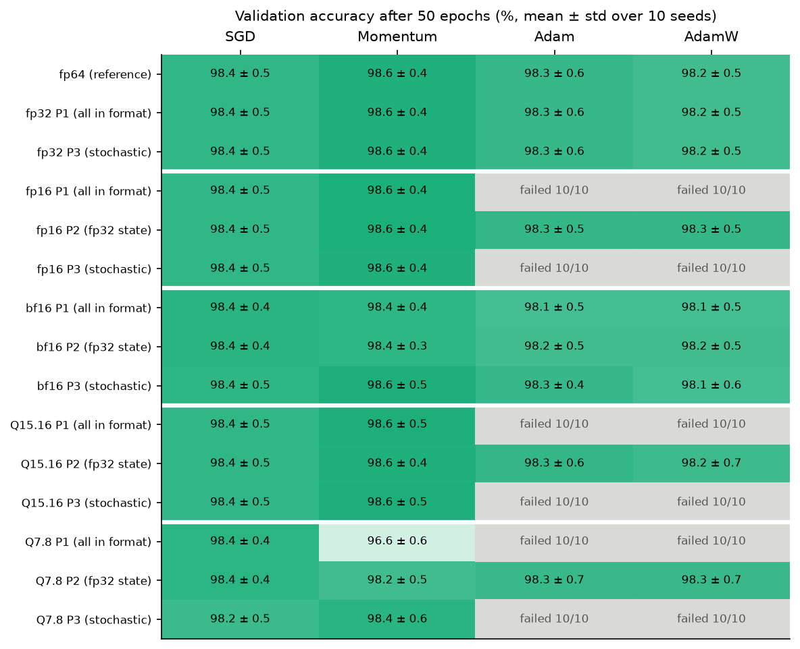
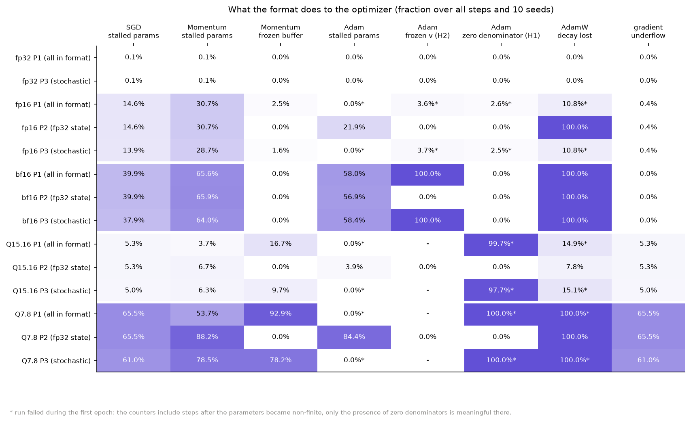
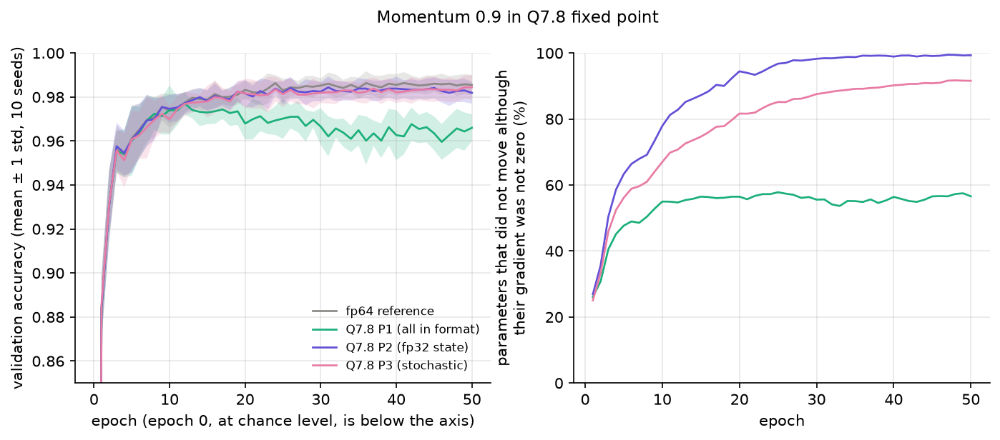
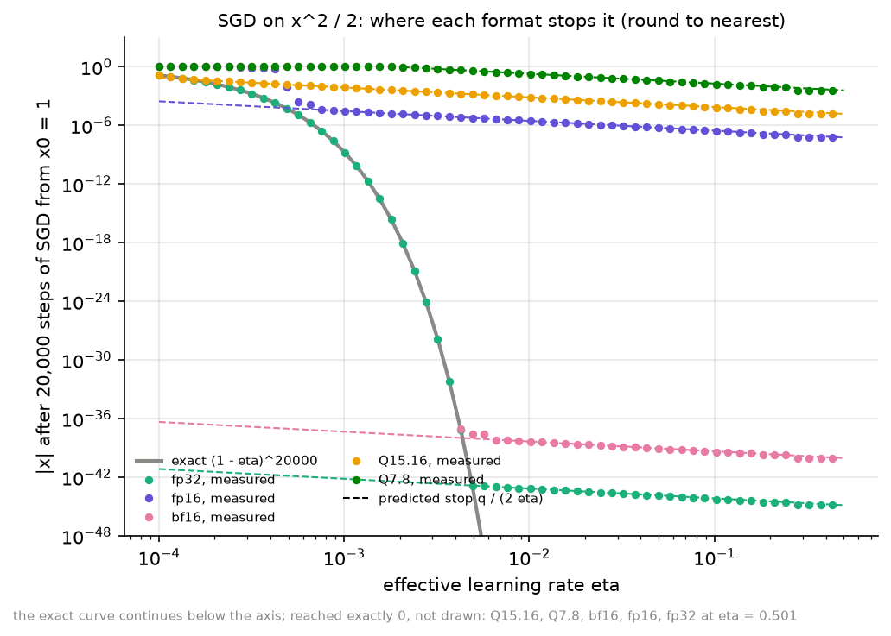

# optimizers-low-precision

[](https://github.com/amine-belkacem/optimizers-low-precision/actions/workflows/tests.yml)

I am writing SGD, Momentum, Adam and AdamW from scratch in NumPy, checking them
against `torch.optim`, and then looking at what happens to each of them when
the arithmetic drops to fp16, bfloat16 or fixed point, the way it does when you
try to train on a microcontroller, an accelerator or an FPGA.

> Work in progress. This repository is built in milestones and this README
> only describes what is already in it. Every number below comes from a
> script in this repository and can be regenerated.

## Status

| Milestone | Content | State |
|---|---|---|
| J0 | Repository skeleton, CI, figure style | done |
| J1 | The four optimizers, differential tests against PyTorch, Rosenbrock | done |
| J2 | NumPy MLP on `digits`, learning-rate sensitivity over 10 seeds | done |
| J3 | Number format emulator (fp32, fp16, bf16, Qm.n) | done |
| J4 | Low-precision study: 600 training runs, 6 formats, 3 precision policies | done |
| J5 | Step time and optimizer memory on a Raspberry Pi 5 | next |

**Short version of what I measured** (details and numbers in the
[low-precision section](#training-in-low-precision)). None of it is new
research. Most of these effects are already documented, see
[what was already known](#what-was-already-known).

- Adam and AdamW **fail in every run** when their state lives in fp16 or in
  fixed point. Adam's `eps = 1e-8` rounds to 0, the second moment `v`
  underflows to 0, and the step divides by zero. Keeping the optimizer
  state in fp32 fixes it. Stochastic rounding does not.
- **AdamW's weight decay disappears** in every 16-bit format: the factor
  `1 - lr·wd = 0.99978` rounds to 1, so AdamW becomes Adam, bit for bit.
- In bf16, Adam's second moment **never decays** (100 % of the steps), as
  predicted from the format alone, and yet accuracy does not move.
- SGD and Momentum still reach float64 accuracy with up to 66 % of their
  parameters stuck at each step. The one real loss, Momentum in 16-bit
  fixed point (96.6 % vs 98.6 %), comes from a momentum buffer that rounding
  keeps from decaying. An fp32 buffer or stochastic rounding brings it back.

## The optimizers

All four live in [`src/lpopt/optimizers.py`](src/lpopt/optimizers.py), about
200 lines with the docstrings. They follow the update rules of `torch.optim`
(PyTorch 2.x), including two details that are easy to get wrong:

- **SGD with momentum** stores the raw gradient as its first buffer, without
  dampening. The textbook version `b1 = (1 - dampening) * g1` gives a
  different first step as soon as dampening is not zero.
- **Adam vs AdamW.** Adam's `weight_decay` is an L2 term added to the gradient,
  and Adam then divides it by `sqrt(v)` like the rest of the gradient. On the
  first step it is almost completely normalized away: with `p = 1`, `g = 0.5`,
  `lr = 0.1` and a decay of 0.5, Adam + L2 moves `p` to 0.900000001 and
  AdamW to 0.850000002. AdamW shrinks the parameters directly,
  `p *= 1 - lr * weight_decay`, before the Adam step. Both values are checked
  by hand in [`tests/test_optimizers_hand.py`](tests/test_optimizers_hand.py).

The parameters are updated in place and the arithmetic stays in their dtype,
so the same code runs in float64 or float32. That matters for the next
milestones, where the format becomes the variable under study.

## How I check them

| Test | What it does |
|---|---|
| Hand-computed steps | 1 or 2 steps of each optimizer on a scalar. Expected values derived by hand, then confirmed with exact fractions and 40-digit decimals |
| Differential, 1000 steps | Same initial parameters and same gradients fed to lpopt and `torch.optim`, 9 configurations, float64 and float32 |
| Differential, random settings | Hypothesis draws 60 random configurations (learning rate, betas, eps, momentum, dampening, Nesterov, weight decay) |
| Mutation testing | 10 plausible bugs injected into a copy of `optimizers.py`. The differential bench has to catch every one |
| Closed form | Plain SGD on a quadratic follows `x_k = (1 - lr*a)^k x_0`. With `a = 1, lr = 0.5` this is exact, so the test compares bit for bit |

The differential tests feed the same precomputed gradients to both sides
(open loop), so any difference comes from the optimizers and not from a
feedback loop that would amplify it.

### Distance to PyTorch


Worst case over 10 seeds and 1000 steps, default settings of each optimizer
([`results/differential_summary.csv`](results/differential_summary.csv)):

| Optimizer | float64 | float32 |
|---|---|---|
| SGD | 9.0e-16 | 6.5e-7 |
| Momentum | 6.4e-16 | 2.7e-7 |
| Adam | 4.3e-16 | 2.5e-7 |
| AdamW | 4.6e-16 | 3.6e-7 |

That is a handful of roundings in each dtype, against test thresholds of
1e-10 (float64) and 1e-5 (float32). The threshold has margin, but it is not
lax: the hardest mutant to catch, `eps` moved inside the square root, still
produces an error of 9.5e-4.

### Why the error is not zero

My first run in float32 gave **exactly zero** error for SGD while float64 did
not, which is backwards. Comparing torch against exact rational arithmetic
explained it: on my CPU (AVX2, PyTorch 2.14.1), `p.add_(g, alpha=-lr)` uses a
fused multiply-add, one rounding instead of two, but only on full vector
blocks of 8 float64 or 16 float32 values. The tail of the tensor goes
through the plain multiply then add. My first test tensors had 15 and 7
elements, so in float32 they never reached a full block. The bench now also
has a 64-element parameter so both code paths run in both dtypes.

So the same element can be rounded differently by torch depending on the size
of the tensor it sits in. lpopt rounds after every operation, which is
predictable and is what the format emulator of J3 will build on.

## Rosenbrock

`f(x, y) = (1 - x)^2 + 100 (y - x^2)^2`, from the classic start (-1.2, 1),
5000 steps. Comparing optimizers at one hand-picked learning rate mostly
measures how well that rate was picked, so each optimizer gets the same
11-point grid from 1e-5 to 1 and keeps its best rate.


What I take from it ([`results/rosenbrock_lr_grid.csv`](results/rosenbrock_lr_grid.csv)):

- **SGD** cannot go faster: at 1e-2 it diverges, at its best rate (1e-3) it
  is still crawling along the valley, loss 3.8e-3 after 5000 steps.
- **Momentum** reaches 1.2e-30 at 3.2e-3, 3.5e-16 away from (1, 1). That is
  1.6 times the spacing between float64 numbers next to 1.0 (2.2e-16): it has
  reached the float64 floor and oscillates there. This is the kind of limit
  the low-precision milestones are about.
- **Adam** has the widest working range (it never diverged on this grid) and
  reaches 4.4e-31 at 3.2e-2, but takes about 4500 steps to get there.
- **AdamW** stalls around 8.7e-5, 2.1e-2 away from the minimum. This is not a
  bug, the decay does it: at (1, 1) the gradient is zero, so the Adam step
  is zero, but the decay still pulls the parameters towards the origin.
  (1, 1) is no longer a fixed point.

Limits: one start point, a 2-parameter problem, and a deterministic run, so
there is nothing to average. Rosenbrock shows how each update rule moves.
It does not say which optimizer trains a network best, that is what J2 is
for.

## A real network: MLP on digits

**Setup.** A 64-32-10 tanh MLP with a softmax cross-entropy, forward and
backward written by hand in [`src/lpopt/mlp.py`](src/lpopt/mlp.py). The
gradient is checked against central differences (error < 1e-8) and against
`torch.autograd` (relative error < 1e-12). The data is `digits`: 1797 8x8
images of handwritten digits (UCI, CC BY 4.0, shipped with scikit-learn).
It is split once, stratified: 1078 train, 359 validation, 360 test.

**Protocol.** Mini-batches of 64, 50 epochs, 16 learning rates from 1e-4 to
10 (a third of a decade apart), 10 seeds per point. A seed changes the
initial weights and the batch order, never the split. Each optimizer's rate
is chosen on the mean validation loss at the last epoch. The test set is
only read at that rate. In total, 640 training runs, about 3 minutes on a
laptop CPU.

I had planned a grid up to 1. A first look with one seed put SGD's best
rate exactly at 1, on the edge, and a best value on the edge of a grid says
nothing about what lies past it. So the grid goes to 10.


| Optimizer | Chosen lr | Test accuracy (10 seeds) | Test loss | Usable lr range* |
|---|---|---|---|---|
| SGD | 1.0 | 97.11 % ± 0.35 | 0.087 ± 0.010 | 0.22 to 1.0 (0.67 decade) |
| Momentum 0.9 | 0.22 | 97.53 % ± 0.38 | 0.090 ± 0.014 | 0.022 to 0.46 (1.33 decades) |
| Adam | 0.022 | 97.28 % ± 0.39 | 0.091 ± 0.012 | 0.0046 to 0.046 (1.0 decade) |
| AdamW, decay 0.01 | 0.022 | 97.31 % ± 0.37 | 0.087 ± 0.010 | 0.0046 to 0.046 (1.0 decade) |

\* rates whose mean validation accuracy is within one percentage point of
the optimizer's best rate. I fixed this rule before looking at which
optimizer it favors. Source: [`results/lr_sweep_digits_best.csv`](results/lr_sweep_digits_best.csv).

What the numbers say, and what they do not:

- **At its best rate, no optimizer wins.** The four test accuracies sit
  within 0.42 points, about one standard deviation. With 360 test images,
  one image is 0.28 points. On this problem, ranking the optimizers by
  their best score would be reading noise.
- **The difference is in how much tuning they need.** Momentum keeps working
  over 1.33 decades of learning rate, Adam and AdamW over 1.0, plain SGD over
  0.67. Adam having a narrower window than Momentum goes against what is
  often said about Adam. That holds for this network, this criterion and 50
  epochs, nothing more.
- **Momentum 0.9 at lr behaves like SGD at 10·lr**, the classic effective
  rate `lr / (1 - momentum)`. Up to an effective rate of 1 the two curves
  lie on top of each other, within the seed spread. Past that point the
  equivalence breaks: at an effective rate of 4.6, Momentum still reaches
  98.4 % on validation while SGD has collapsed to chance.


- **Lower training loss does not mean a better model.** At their chosen
  rates, Adam ends with a training loss of 1.2e-3 and SGD with 9.8e-3, 8
  times higher, yet their validation losses are 0.059 and 0.063. Most of
  what Adam gains on the training set does not carry over.
- **Adam and AdamW are almost the same here.** Per step the decay removes
  `lr x 0.01` of each weight, 2e-4 at the chosen rate. Over 850 steps it
  does change the weights, but the test results stay inside the noise.
- **Too large a rate does not blow up, it collapses.** No run produced an
  infinite or NaN loss. Past the window, accuracy falls to 10 %, the chance
  level, with a finite loss. I suspect the tanh units saturate, but I have
  not checked it.


Limits: one small dataset, one architecture, a fixed budget of 50 epochs
with no learning-rate schedule, and the rate is picked on the last epoch
instead of the best one. The ranking of the usable windows could change
with any of these. This is a reference point in float64 for the
low-precision study, not a general benchmark of optimizers.

## Emulating number formats

Before training in fp16 or bf16 I need a way to compute in those formats
that I fully control. [`src/lpopt/numerics.py`](src/lpopt/numerics.py)
emulates fp32, fp16, bf16 and signed fixed point Qm.n (here Q7.8 and
Q15.16), with round-to-nearest-even or stochastic rounding.

The rule: to compute `a + b` in fp16, compute it in float64 and round the
result to fp16. This is exact, not an approximation. For +, -, *, / and
sqrt, rounding twice (exact value to float64, then float64 to the target)
gives the same answer as rounding once, provided float64 has at least
2p + 2 bits of precision, where p is the target's (Figueroa, 1995). fp32
has p = 24, fp16 11, bf16 8, so all three qualify. The format class refuses
anything more precise.

How I check it:

| Test | Result |
|---|---|
| Conversion of 1,000,000 random float64 values (1e-45 to 1e42) to fp16 and fp32 | bit-identical to NumPy |
| Same values, as float32, to bf16 | bit-identical to PyTorch |
| `+ - * / sqrt` on about 1,000,000 random operand pairs per operation and format (random bit patterns, so subnormals and extremes included) | bit-identical to NumPy float32, NumPy float16 and PyTorch bfloat16 |
| Hand values: ties to even, overflow at 65520 in fp16, sign of zero, saturation in Q7.8 | pass |
| Stochastic rounding on 200,000 draws | unbiased within 5 standard deviations |

One finding along the way: **PyTorch converts float64 to bfloat16 through
float32, so it rounds twice.** Take x = 1 + 2^-8 + 2^-30. It sits just above
the midpoint between the bf16 neighbors 1 and 1 + 2^-7, so the right answer
is 1.0078125. The float32 step rounds x onto the midpoint exactly, and the
tie then goes to the even neighbor: torch returns 1.0. On my million random
values this happened 10 times, and exact rational arithmetic says the
emulator was the nearest every time. This is why the bf16 check against
torch uses float32 inputs.

### Two predictions for the low-precision study


The figure is computed from the format definitions, not from training.
It already shows where things should go wrong:

- **H1, Adam's eps disappears in fp16.** The smallest fp16 number is
  2^-24 ≈ 6e-8, and anything below half of it rounds to 0. Adam's default
  `eps = 1e-8` is below that, so it rounds to 0. In bf16, which keeps
  fp32's exponent range, it survives with 8 bits of precision. Both are
  tested.
- **H2, Adam's second moment cannot decay in bf16.** Each step multiplies
  `v` by beta2 = 0.999, a change of 0.1 %. bf16 values are 2^-8 to 2^-7
  apart in relative terms, so 0.1 % is always less than half a spacing.
  I checked all 32,512 positive normal bf16 values: `round(0.999 * v)`
  gives back `v` every time. In fp16 the same product changes every normal
  value. What this does to training, given that Adam also adds
  `(1 - beta2) g^2` to `v` at each step, is what J4 measures.

## Training in low precision

### Setup

[`src/lpopt/lowprec.py`](src/lpopt/lowprec.py) runs the four optimizers
in an emulated format. Every elementary operation is rounded, in exactly
the order the float64 code of J1 evaluates it. The check: in fp16 and
fp32, the emulation gives **bit-identical** parameters to the J1 code run on
native `np.float16` / `np.float32` arrays (9 settings, 200 steps, 3
parameter arrays). So the emulation is the J1 code, plus formats NumPy does
not have.

A precision policy says what lives in which format:

| Policy | Parameters and gradients | Optimizer state and arithmetic | Rounding |
|---|---|---|---|
| P1 | format | format | to nearest |
| P2 | format | fp32 | to nearest |
| P3 | format | format | stochastic |

The network itself computes in float64 from parameters that hold values of
the format, and its gradients are rounded to the format before the
optimizer sees them. The study is about the optimizer, so that is where
every operation is emulated.

Same MLP, data split, batch size and 50 epochs as in J2. Each optimizer
uses its learning rate chosen in float64 (J2). 15 configurations x 4
optimizers x 10 seeds = **600 runs**, about 5 minutes on 7 processes. The
optimizer counts what goes wrong at each step: parameters that did not
move although their gradient was not zero, decays that round back to the
same value, zero denominators, gradients that underflow.





Numbers: [`results/precision_summary.csv`](results/precision_summary.csv)
(one row per optimizer, format and policy).

### H1: Adam divides by zero in fp16 and in fixed point

Adam and AdamW fail in **10 runs out of 10**, during the first epoch, in
fp16 P1 and P3 and in both fixed-point formats under P1 and P3. Hand
derivation of one fp16 step (`p = 1`, `g = 1e-4`), checked by a test:

- `v = (fp16(0.001) x 1e-4) x 1e-4`: the first product is already a
  subnormal (1.19e-7) and the second one, 1.2e-11, rounds to **0**;
- `m = fp16(0.1) x 1e-4 = 1.0e-5`, not zero;
- `denominator = sqrt(0) / c + fp16(1e-8) = 0 + 0 = 0`, so the step is `m / 0 = inf`.

In Q15.16 and Q7.8, `eps` and most of `v` are below the resolution, so
97.7 % to 100 % of the denominators are 0. Stochastic rounding (P3)
does not help: it cannot bring back a constant that was 0 to begin with,
nor a `v` that is a hundred times smaller than the resolution. **Keeping the
state in fp32 (P2) brings every run back**, to 98.3 % in fp16, Q15.16 and Q7.8.

### H2: Adam's second moment never decays in bf16

As predicted in J3 from the format alone, `beta2 * v` rounds back to `v` in
**100 %** of the steps in bf16 P1 and P3, in real training this time. And it
costs nothing measurable here: 98.1 % ± 0.5 against 98.3 % ± 0.6 in float64,
validation loss 0.0595 against 0.0591. My reading, which I have not tested:
without the decay, `v` becomes a running sum of `(1 - beta2) g^2`, so Adam
behaves more like Adagrad, whose steps keep shrinking. Over 850 steps that
seems harmless. Over a much longer training it might not be.

### AdamW's weight decay disappears in 16-bit formats

At AdamW's chosen rate, the decay multiplies each weight by
`1 - lr·wd = 1 - 0.021544 x 0.01 = 0.99978`. Half the relative spacing of
fp16 is at least 2^-12 = 2.4e-4, more than 2.2e-4, so the constant itself
rounds to 1 (P1), and with an fp32 constant (P2) the decayed value rounds
back to the same fp16 when it is stored. A test checks every normal fp16
value. bf16 is coarser still. **In fp16 and bf16, AdamW is Adam,
bit for bit**: same validation loss for each seed in fp16 P2, bf16 P1 and
bf16 P2. In bf16 P3 the two differ only because the skipped decay still
draws random numbers for its stochastic rounding, which shifts the random
stream. In Q15.16 with fp32 state
part of the decay survives (lost 7.8 % of the time), and AdamW then differs
from Adam (validation loss 0.0555 against 0.0588).

### SGD and Momentum: many stuck parameters, almost no damage

In bf16, 40 % (SGD) and 66 % (Momentum) of the parameter updates are
lost at each step, and the accuracy is the float64 one within noise. The
small updates that disappear apparently do not matter much here. The large
ones still go through.

The exception is **Momentum in Q7.8 P1: 96.6 % ± 0.6 instead of 98.6 % ± 0.4**,
and a validation loss three times higher (0.18 against 0.06). Paradoxically
fewer parameters are stuck than with an fp32 buffer (P2: 88 % stuck, 98.2 %
accuracy). The counters point to the momentum buffer: it is frozen in
**92.9 %** of the steps. Small buffers stop decaying, and they keep pushing.
Hand example, checked by a test: a buffer of 4 x 2^-8 times 0.9 is 3.6
resolutions, which rounds back to 4. `lr x buffer` is 0.86 resolution,
which rounds to 1. With zero gradients for 20 steps the parameter still
moves by 21 resolutions in total (to 0.918), where float64 would stop at
0.970.



An fp32 buffer (P2) or stochastic rounding (P3, 98.4 %) fixes it. With
stochastic rounding the buffer still stays the same in 78 % of the steps,
but its decay is right on average. What hurts is the systematic bias of
round-to-nearest, not the fact that a value sometimes does not change.

### Where SGD stops: a rule that predicts it

On `f(x) = x^2 / 2` the SGD step is `round(eta * x)`, and it vanishes once it
is at most half the spacing of the format around `x`. Where the spacing is a
constant `q` (fixed point, or the subnormal range of a float), SGD stops just
under `x* = q / (2 eta)`. One run with 60 coordinates covers 60 effective
rates `eta` (lr = 1, curvature = eta), for 20,000 steps
([`experiments/quadratic_stall.py`](experiments/quadratic_stall.py)).



- **Never leaves x0 = 1** for `eta <= 2.38e-4` in fp16 and `eta <= 1.80e-3` in
  bf16 and Q7.8. The predicted thresholds are 2^-12 = 2.44e-4 and
  2^-9 = 1.95e-3, and the next point of the grid is above them in each case.
- **Fixed point: 96 cases out of 96** end inside the predicted interval
  `(x* - q, x*]`. fp32: every case either follows the exact curve or ends
  inside it.
- **fp16 and bf16**: when `eta` is between 2^-(p+1) and 2^-p (p = 11 in
  fp16, 8 in bf16), SGD stops much earlier, in the normal range, where the
  sawtooth relative spacing is widest. All 9 such cases stop with a step of
  0.50 spacing, as the rule says, and so does one case just above the
  window (0.503). Five more cases stop with a step of 0.55 to 0.75 spacing,
  and **I have not explained those yet**.
- **Stochastic rounding has no floor**: 53 % to 87 % of the (eta, seed) pairs end
  at exactly 0.

### Limits

- Every optimizer uses its float64 learning rate. Low precision may move the
  best rate, and a sweep per configuration would cost 16 times more.
- Only the optimizer is emulated. The network computes in float64 and only
  its gradients are rounded. A real fp16 forward and backward pass would
  add its own errors.
- P2 keeps the parameters in the low format. Full mixed precision also keeps
  an fp32 master copy of the weights, which would remove most stuck
  parameters. That is a natural next experiment, not done here.
- No loss scaling (the usual fix for fp16 gradient underflow). Here only
  0.4 % to 1.8 % of the fp16 gradients underflowed.
- One small task, 50 epochs. The "no measurable cost" results (H2, stuck
  parameters) are about this setting, not a general claim.
- When a run fails in its first epoch, its counters include the steps after
  the parameters became non-finite. There, only the presence of zero
  denominators is meaningful. The cause is established by the hand-derived
  tests, not by those percentages.

## What was already known

This is a learning and engineering project, not research. I measured
every effect in this README myself, but almost none of them is a discovery.
Here is what I found already written down, checked on 2026-10-20 with a web
search and a search of the PyTorch issue tracker. Not finding a source
does not mean none exists.

| What this repository shows | Already known? |
|---|---|
| Optimizers written from scratch and checked against PyTorch | A very common exercise. What I add is the testing method (differential bench, mutation testing), not the optimizers. |
| Momentum at lr behaves like SGD at lr / (1 - momentum) | Textbook. |
| Adam's L2 term is normalized away, AdamW decouples it | Loshchilov and Hutter (2019), the reason AdamW exists. |
| torch rounds `add(alpha)` once on vector blocks and twice on the tail (J1) | Yes, same mechanism: [pytorch/pytorch#199449](https://github.com/pytorch/pytorch/issues/199449) (opened 2026-10-02, still open) reports it for bf16/fp16 and traces it to `vec::fmadd` against `self + alpha * other` in `aten/src/ATen/native/ufunc/add.h`. I saw it in float32 and float64. |
| torch converts float64 to bf16 through float32, so it rounds twice (J3) | I found no report in the PyTorch issues (searched "bfloat16 double rounding", "float64 bfloat16 rounding", "double to bfloat16"). Double rounding itself is classic numerical analysis (Figueroa, 1995). |
| Emulate a format by computing in float64 and rounding | A standard technique, used for instance by QPyTorch (Zhang et al., 2019), with the exactness condition from Figueroa (1995). |
| H1: Adam's `eps = 1e-8` is 0 in fp16 and the step divides by zero | Yes. Known in practice since at least 2017 ([PyTorch forum](https://discuss.pytorch.org/t/adam-half-precision-nans/1765): raise eps or keep Adam's state in fp32), and analyzed in [arXiv 2307.16189](https://arxiv.org/abs/2307.16189). My P2 policy is that known fix. |
| Small updates are lost in 16-bit, stochastic rounding brings them back | Yes. Gupta et al. (2015) for stochastic rounding in fixed point, Micikevicius et al. (2018) for fp32 master weights, [Zamirai et al. (2020)](https://arxiv.org/abs/2010.06192) for bf16 weight updates (stochastic rounding and Kahan summation). |
| H2: bf16 freezes Adam's second moment; AdamW's decay vanishes in 16-bit; Momentum's buffer freezes in fixed point | I found no source naming these three cases specifically. They are direct instances of the lost-small-update effect above, so I would not call them new. |
| Where SGD stops: `x* = q / (2 eta)` | A direct consequence of how rounding works. I would be surprised if it were new. |

What the repository does add is putting all of this in one place, in a
form anyone can rerun and check: an emulator proven bit-exact against
native arithmetic, 600 seeded runs, counters that tie each failure to its
mechanism, and hand-derived tests for each mechanism.

## Reproduce

Python 3.10 or newer. PyTorch is only the reference in the tests and in the
differential experiment, so the CPU wheel is enough:

```bash
python -m venv .venv
.venv/bin/pip install torch --index-url https://download.pytorch.org/whl/cpu
.venv/bin/pip install -r requirements.txt
.venv/bin/pip install -e .
.venv/bin/pytest                          # 237 tests, about 40 s
.venv/bin/python -m experiments.run_all   # results/, about 15 min on 8 cores
.venv/bin/python -m figures.make_all      # docs/img/
```

On Windows, replace `.venv/bin/` with `.venv\Scripts\`.

## Layout

```
src/lpopt/       optimizers, number formats, MLP, tasks, training loops, figure style
experiments/     scripts that write results/ (CSV summaries are committed)
figures/         scripts that turn results/ into docs/img/
tests/           pytest + Hypothesis, run by GitHub Actions on every push
```

## References

- D. P. Kingma, J. Ba, *Adam: A Method for Stochastic Optimization*, ICLR 2015.
- I. Loshchilov, F. Hutter, *Decoupled Weight Decay Regularization*, ICLR 2019.
- S. A. Figueroa, *When is double rounding innocuous?*, ACM SIGNUM Newsletter 30(3), 1995.
- S. Gupta, A. Agrawal, K. Gopalakrishnan, P. Narayanan, *Deep Learning with Limited Numerical Precision*, ICML 2015 (stochastic rounding in fixed point).
- P. Micikevicius et al., *Mixed Precision Training*, ICLR 2018 (fp32 master weights, loss scaling).
- P. Zamirai, J. Zhang, C. R. Aberger, C. De Sa, *Revisiting BFloat16 Training*, [arXiv 2010.06192](https://arxiv.org/abs/2010.06192), 2020.
- T. Zhang, Z. Lin, G. Yang, C. De Sa, *QPyTorch: A Low-Precision Arithmetic Simulation Framework*, [arXiv 1910.04540](https://arxiv.org/abs/1910.04540), 2019.
- J. Yun, *Stabilizing Backpropagation in 16-bit Neural Training with Modified Adam Optimizer*, [arXiv 2307.16189](https://arxiv.org/abs/2307.16189), 2023.
- IEEE 754-2019, *Standard for Floating-Point Arithmetic*.
- E. Alpaydin, C. Kaynak, *Optical Recognition of Handwritten Digits*, UCI Machine Learning Repository, 1998, CC BY 4.0.
- X. Glorot, Y. Bengio, *Understanding the difficulty of training deep feedforward neural networks*, AISTATS 2010 (weight initialization).
- H. H. Rosenbrock, *An Automatic Method for Finding the Greatest or Least Value of a Function*, The Computer Journal, 1960.
- [`torch.optim` documentation](https://pytorch.org/docs/stable/optim.html), the reference implementation.

## License

MIT, see [LICENSE](LICENSE).
